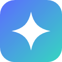
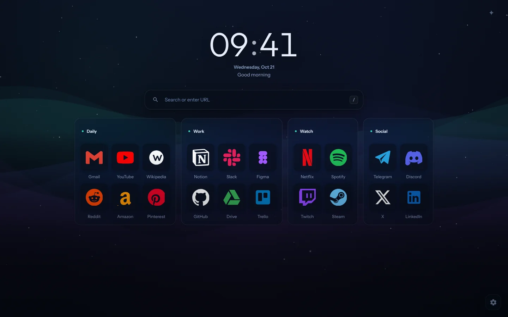
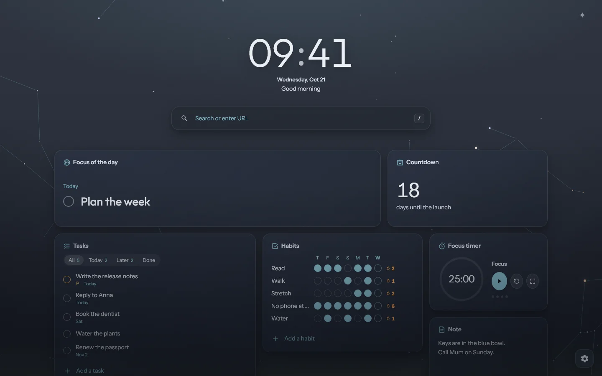

<p align="center">
  
</p>

<h1 align="center">Nordlys</h1>

<p align="center">
  Your bookmarks on every new tab, over a sky that moves.
</p>

<p align="center">
  <a href="https://chromewebstore.google.com/detail/nordlys/fepiibfbbjhaoldgcfpfcikbonnjbfdc">Chrome Web Store</a> ·
  <a href="PRIVACY.md">Privacy</a> ·
  <a href="CHANGELOG.md">Changelog</a> ·
  <a href="CONTRIBUTING.md">Contributing</a>
</p>

<p align="center">
  
</p>

I wanted a new tab page with my bookmarks and something nice to look at, so I made one.

- Bookmarks in folders. Drag the folders around, set tile size and spacing, undo a change.
- Nine skies drawn live in the browser and 21 themes, or your own picture or looping video.
- A search box that uses your browser's engine, finds your sites as you type, does sums and runs commands after `>`.
- Brand icons by name, a site's favicon, an image link or a letter.
- A dashboard if you want one: tasks, a focus timer, notes, weather, world clocks, plus tasks and events from Todoist, GitHub or any calendar link.
- Profiles for Work and Home. Turn on sync and your browser carries them to your other computers.
- Start from your browser's bookmarks, or import a backup from FVD Speed Dial, Speed Dial 2, Infinity, nightTab, Bonjourr or Tabliss.
- English, Russian, Spanish, German, French, Japanese, Chinese and Turkish.

<p align="center">
  
</p>

## Free, and staying free

Nordlys is free, and what is free stays free. There is no paid plan and there won't be one, and there are no ads. If you'd like to say thanks, Settings → Support has a "Buy me a coffee" link.

## Install

Get it from the [Chrome Web Store](https://chromewebstore.google.com/detail/nordlys/fepiibfbbjhaoldgcfpfcikbonnjbfdc). The same listing works in Edge, Brave, Opera and other Chromium browsers.

To run it from source, clone the repo, open `chrome://extensions`, turn on Developer mode, click Load unpacked and pick the folder.

## Privacy

There's no account, no server and no tracking. A new tab without dashboard cards makes no network request at all. Your setup stays in your browser, and leaves it only through the browser's own sync, if you turn that on. Searches, icon lookups, weather and connected apps go online when you use them, each straight to its own service. [PRIVACY.md](PRIVACY.md) lists every request.

## Development

Plain JavaScript and CSS, with no build step.

```sh
npm install
npm test        # lint, unit tests and browser tests
npm run ports   # packages for Chrome, Edge and Firefox, and a folder for Safari
```

[CONTRIBUTING.md](CONTRIBUTING.md) explains how the code is laid out and which rules the tests hold you to.

The version reads 2.x because store versions can only go up, but Nordlys is still a beta. Before an update changes how your setup is stored, it keeps a copy you can restore in Settings → Backup.

## License

[MIT](LICENSE)
